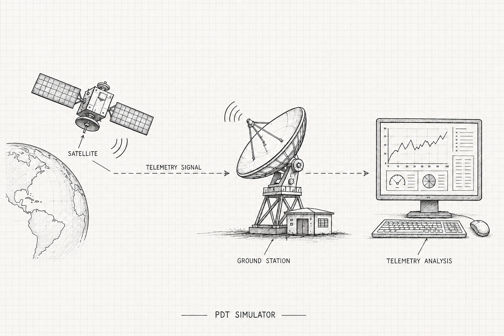
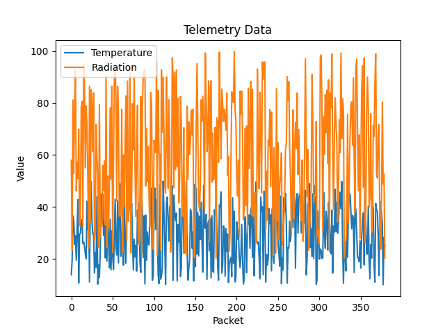
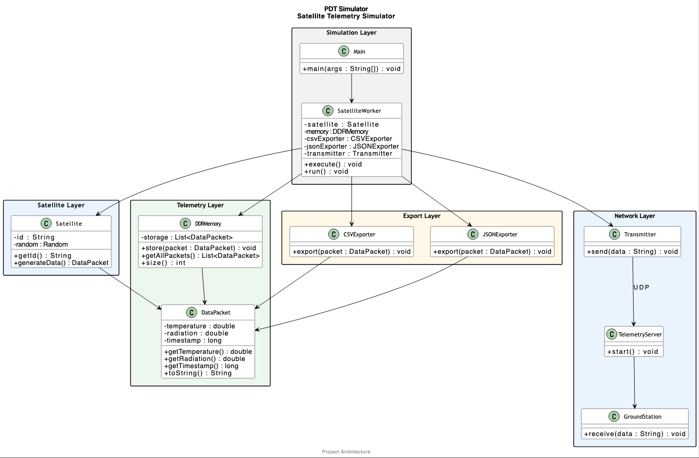
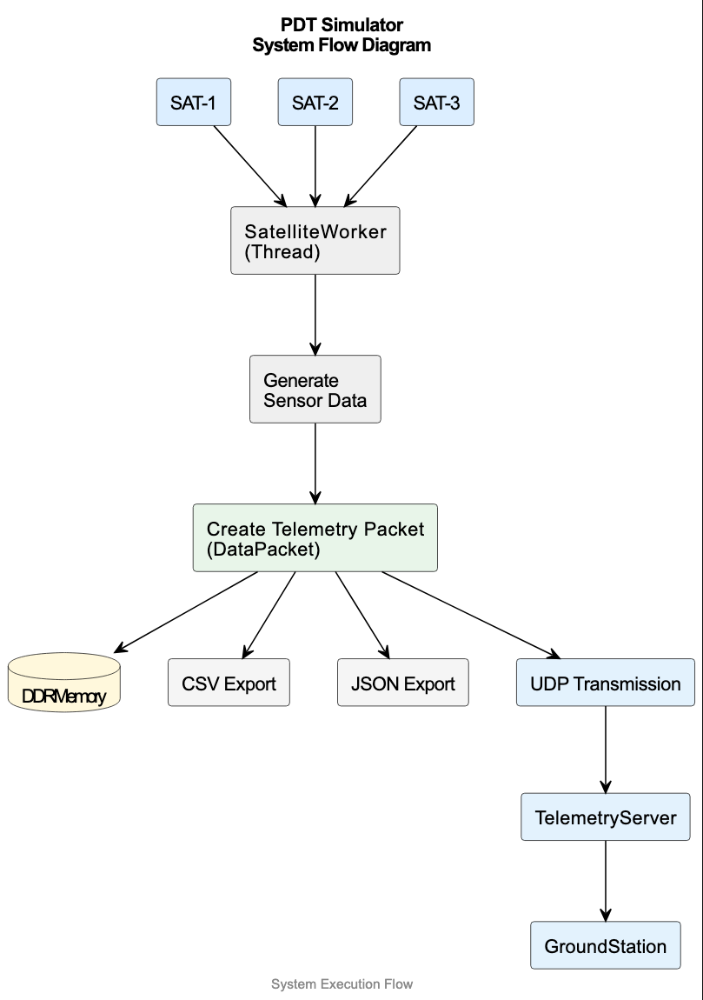

# Satellite Telemetry Simulator

<p align=>
  
</p>

<p align=>
  Realistic satellite telemetry simulation platform built with Java and Python.
</p>

---

## Overview

Satellite Telemetry Simulator is a software engineering project designed to emulate the complete telemetry lifecycle of a satellite communication system.

The simulator generates realistic telemetry data, stores packets in memory, exports information to CSV and JSON formats, transmits telemetry through a UDP communication layer, and performs telemetry analysis using Python.

The project combines software architecture, multithreading, network communication, telemetry processing, and data visualization into a single integrated platform.

---

## Features

→ Realistic telemetry generation

→ Multi-satellite simulation

→ Multithreaded execution

→ DDR memory storage

→ CSV export

→ JSON export

→ UDP communication

→ Ground station reception

→ Packet loss simulation

→ Network latency simulation

→ Python telemetry analysis

→ Telemetry visualization charts

→ UML architecture documentation

→ System flow documentation

---

## Telemetry Analysis

Example telemetry visualization generated from exported satellite data.

<p align=>
  
</p>

---

## Architecture

### UML Class Diagram

<p align=>
  
</p>

### System Flow Diagram

<p align=>
  
</p>

---

## Project Structure

```text
PDT-Simulator/
│
├── docs/
│   ├── ARCHITECTURE.md
│   ├── hero-image.png
│   ├── uml-class-diagram.png
│   └── system-flow-diagram.png
│
├── java-simulator/
│   └── src/
│       │
│       ├── ddr/
│       │   └── DDRMemory.java
│       │
│       ├── export/
│       │   ├── CSVExporter.java
│       │   └── JSONExporter.java
│       │
│       ├── packet/
│       │   └── DataPacket.java
│       │
│       ├── network/
│       │   └── Transmitter.java
│       │
│       ├── satellite/
│       │   ├── Satellite.java
│       │   └── SatelliteWorker.java
│       │
│       ├── server/
│       │   ├── GroundStation.java
│       │   └── TelemetryServer.java
│       │
│       └── simulation/
│           └── Main.java
│
├── python-analysis/
│   ├── reader.py
│   └── telemetry_chart.png
│
├── README.md
├── requirements.txt
└── .gitignore
```

---

## Technologies

* Java
* Python
* UDP Networking
* Multithreading
* CSV Processing
* JSON Processing
* PlantUML
* Draw.io
* Git
* GitHub

---

## Documentation

🏗️ Architecture Documentation: [ARCHITECTURE.md](docs/ARCHITECTURE.md)

---

## Author

Matheus C.

Software Engineering Project

Satellite Telemetry Simulator
