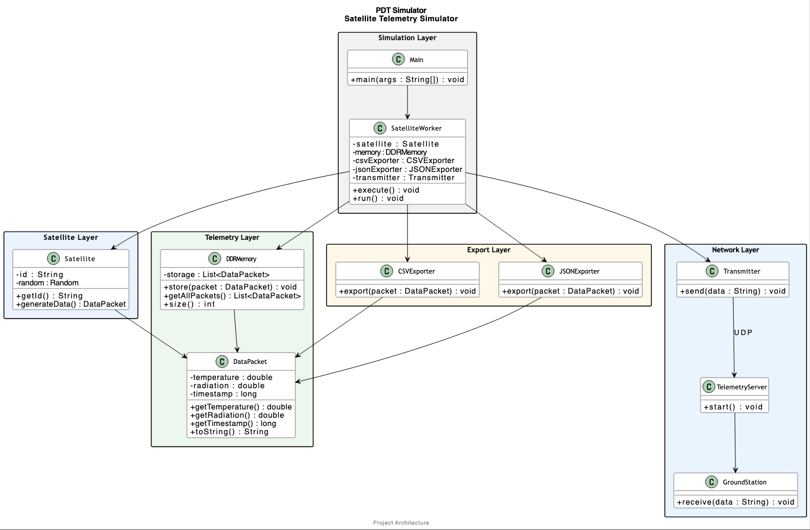
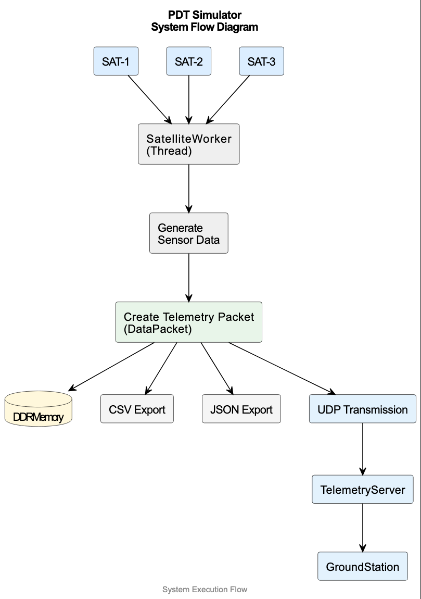

# PDT Simulator Architecture

Satellite Telemetry Simulator

---

> Architecture and system design documentation for the PDT Simulator project.

---

## Overview

════════════════════════════════

PDT Simulator is a satellite telemetry simulation platform designed to emulate the complete lifecycle of telemetry acquisition, storage, export and transmission.

The system generates realistic telemetry data from multiple simulated satellites, stores packets in memory, exports information to structured formats (CSV and JSON), and transmits telemetry through a UDP-based communication layer to a ground station.

The project was developed following software engineering principles, including modular architecture, multithreading, network simulation, UML modeling, and technical documentation.

---

## Architecture Layers

════════════════════════════════

### Simulation Layer

→ Responsible for application orchestration and concurrent execution of satellite workers.

Components

Main

SatelliteWorker

### Satellite Layer

→ Responsible for telemetry generation and satellite behavior simulation.

Components

Satellite

### Telemetry Layer

→ Responsible for telemetry packet representation and temporary memory storage.

Components

DataPacket

DDRMemory

### Export Layer

→ Responsible for persistent telemetry export.

Components

CSVExporter

JSONExporter

### Network Layer

→ Responsible for telemetry transmission and reception through UDP communication.

Components

Transmitter

TelemetryServer

GroundStation

---

## Architecture Diagrams

════════════════════════════════

### UML Class Diagram

The UML Class Diagram represents the static architecture of the simulator and the relationships between its components.

  

---

### System Flow Diagram

The System Flow Diagram illustrates the complete telemetry lifecycle, from satellite data generation to ground station reception.

  

---

## Execution Flow

════════════════════════════════

The simulator executes the following workflow:

1. Satellites generate telemetry data.

2. SatelliteWorker threads process telemetry packets.

3. Telemetry packets are stored in DDR memory.

4. Data is exported to CSV and JSON formats.

5. Packets are transmitted through UDP communication.

6. TelemetryServer receives incoming telemetry.

7. GroundStation processes and displays the received data.

---

## Design Principles

════════════════════════════════

The system was designed following the principles below:

Modular architecture

Separation of concerns

Multithreaded execution

Network simulation

Extensible telemetry processing

Clear documentation and UML modeling

---

## Current Features

════════════════════════════════

* Multi-satellite simulation

* Multithreaded execution

* DDR memory storage

* CSV export

* JSON export

* UDP communication

* Packet loss simulation

* Network latency simulation

* Ground station reception

* UML architecture documentation

* System flow documentation

---

## Version

════════════════════════════════

Version: v0.7 – Realistic Telemetry Simulator

